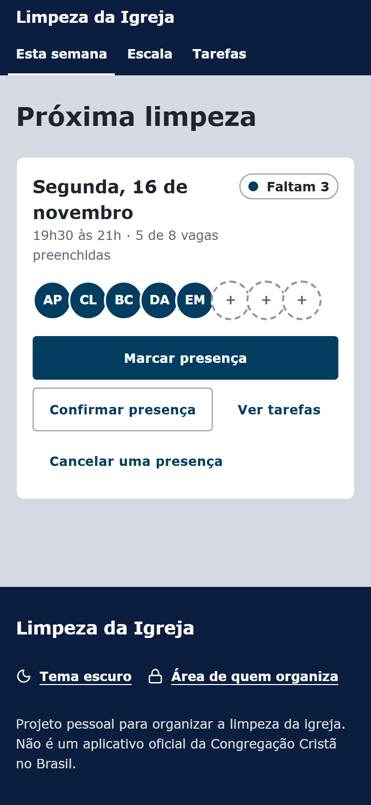
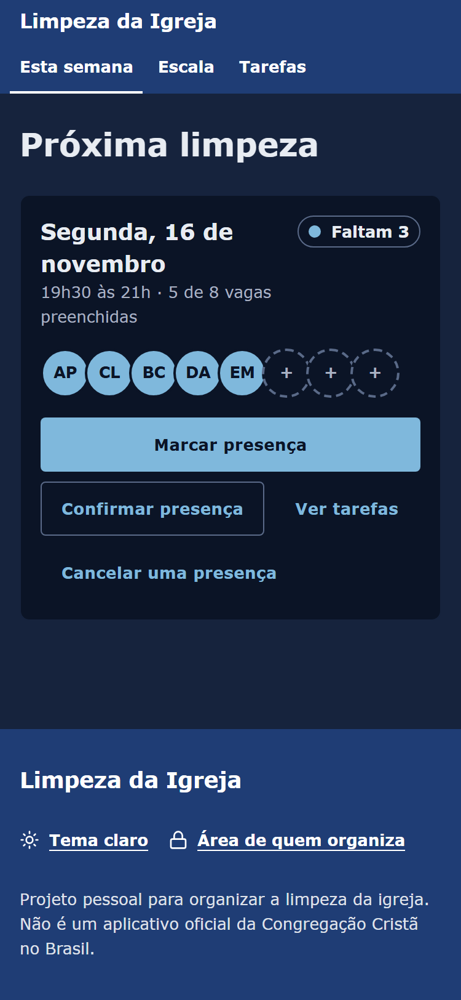
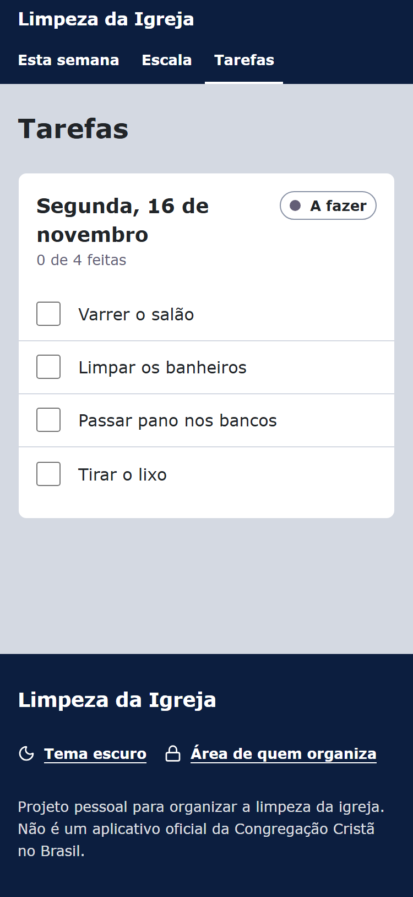
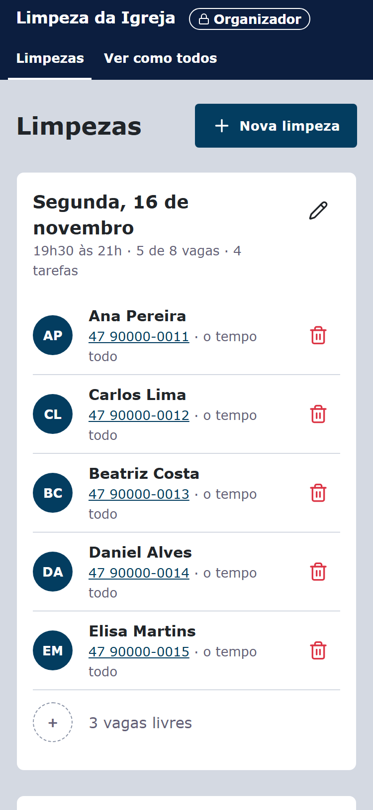
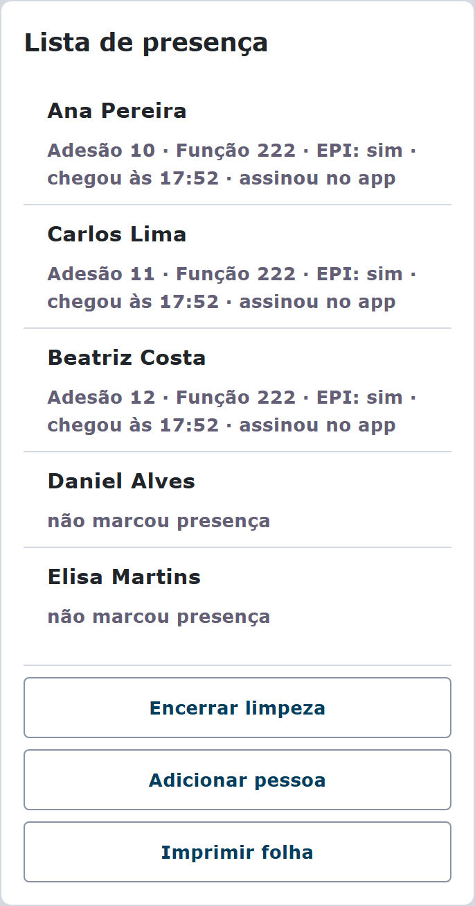
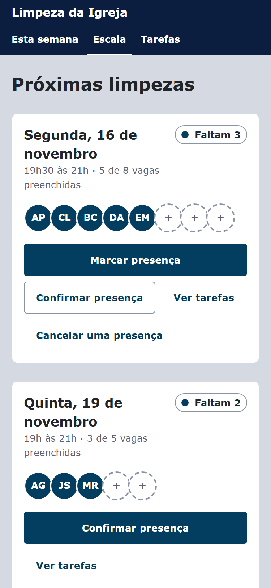
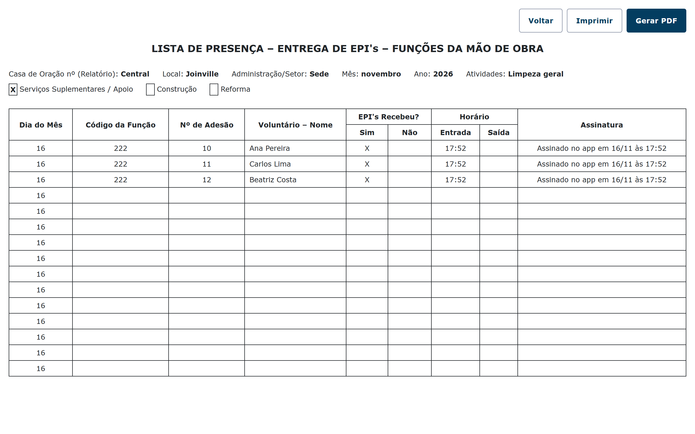
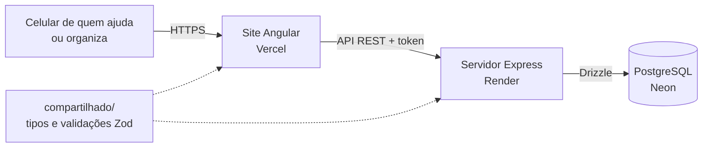

# Limpeza da Igreja

Aplicativo web para organizar os mutirões de limpeza da igreja: **quem vem, quando vem e o que já foi feito**.
Feito para ser usado no celular, por pessoas de todas as idades, sem cadastro e sem senha.

**[Ver o app no ar →](https://limpeza-igreja.vercel.app)**

> Projeto pessoal. Não é um aplicativo oficial da Congregação Cristã no Brasil.

<p align="center">
  
  
  
</p>

## O problema

Organizar uma limpeza voluntária envolve saber quantas pessoas vão, dividir as tarefas e, no dia, preencher a
lista de presença em papel (com a entrega de EPI). O app junta tudo num lugar só:

- **Para quem vai ajudar:** ver as próximas limpezas e as vagas, confirmar presença só com nome e telefone, marcar
  as tarefas como feitas e registrar a chegada no dia, com assinatura pelo próprio celular.
- **Para quem organiza:** criar e editar as limpezas, ver quem confirmou (com telefone), acompanhar a lista de
  presença em tempo real e gerar a folha oficial em PDF, pronta para imprimir.

## Funcionalidades

**Parte pública (sem senha)**
- Próxima limpeza e escala das seguintes, com vagas preenchidas e livres.
- Confirmação de presença com nome, telefone (com máscara enquanto digita) e quanto tempo a pessoa pode ficar.
- Cancelamento pelo próprio celular (um código fica guardado no aparelho) ou pelo telefone usado na confirmação.
- Lista de tarefas que qualquer pessoa marca como feita, com "Desfazer".
- Marcação de presença **no dia**: chegada, saída, entrega de EPI e assinatura no app.
- Tema claro e escuro, que fica lembrado no aparelho.

**Área de quem organiza (com senha)**
- Criar, editar e apagar limpezas, com tarefas sugeridas a partir das anteriores.
- Ver quem confirmou, com telefone, e remover pessoas (com "Desfazer").
- Lista de presença da limpeza e cadastro de quem chegou sem confirmar.
- **Folha de presença** igual à de papel ("Lista de presença – Entrega de EPI's"): impressão em A4 deitado ou
  **PDF baixado direto**, com o cabeçalho que pode ficar salvo como padrão.

<p align="center">
  
  
  
</p>

<p align="center">
  
</p>

## Tecnologias

| Parte | Tecnologias |
| --- | --- |
| Site | Angular 22 (standalone, signals, sem zone.js), formulários reativos, SCSS, jsPDF |
| Servidor | Node.js 24, Express 5, TypeScript, Drizzle ORM, bcrypt, Helmet, pino |
| Banco | PostgreSQL 18 com migrações versionadas |
| Compartilhado | Zod (validações e tipos usados pelo site **e** pelo servidor) |
| Testes | Vitest (unidade e API com banco real) e Playwright (ponta a ponta) |
| Hospedagem | Vercel (site), Render (servidor) e Neon (banco) |

## Decisões técnicas em destaque

- **Uma regra, um lugar.** O projeto é um monorepo com npm workspaces. Tipos, validações (Zod), mensagens de erro,
  datas e formatação de telefone ficam no pacote `compartilhado/`, usado pelo site e pelo servidor. A mesma
  validação que mostra o erro embaixo do campo é a que protege a API.
- **Privacidade (LGPD).** O telefone e a observação **nunca** saem pela parte pública da API: um único mapeador
  monta tudo o que a API devolve, e um teste automático varre as respostas públicas atrás de campos proibidos.
  Os logs não guardam nome, telefone nem senha.
- **Segurança.** A senha de organizador existe só como hash bcrypt numa variável de ambiente. Há sessão com
  validade, limite de tentativas por endereço (sem permitir falsificar o IP atrás do proxy da hospedagem), limite
  de escritas por minuto e cabeçalhos de segurança.
- **Concorrência.** Duas pessoas confirmando ao mesmo tempo na última vaga: só uma consegue, garantido por
  transação no banco, e não por um `if` no código.
- **Design system próprio.** Cores, tamanhos e espaçamentos vêm de `design-system/tokens.json`, que gera as
  variáveis CSS dos dois temas. Nenhuma cor é escrita à mão nas telas. A impressão sai sempre no tema claro.
- **Celular primeiro.** As telas são pensadas para 375px, com toque mínimo de 44px e sem rolagem lateral (isso é
  conferido nos testes).
- **PDF de verdade.** A folha é montada com jsPDF como texto (não como foto da tela), carregado só quando alguém
  clica em "Gerar PDF". A tela, a impressão e o PDF usam a mesma fonte de conteúdo.


## Testes

| Pacote | O que cobre | Quantidade |
| --- | --- | --- |
| `compartilhado` | Validações, datas, telefone e regras puras | 78 |
| `servidor` | Cada rota da API contra um PostgreSQL de verdade, LGPD, limites e segurança | 134 |
| `site` | Componentes, conteúdo da folha e o PDF gerado | 36 |
| Ponta a ponta | 32 cenários num navegador de verdade, a 375px, nos temas claro e escuro | 32 |

## Como rodar no seu computador

**Precisa ter:** Node.js 24.15+ (ou 22.22.3+) e Docker Desktop, para o banco.

```bash
npm install
```

```bash
cp servidor/.env.exemplo servidor/.env
```

Gere o hash da senha de organizador e cole a linha que o comando mostrar no `servidor/.env`:

```bash
npm run gerar-hash-senha --workspace servidor
```

Coloque limpezas de exemplo (apaga o que houver no banco de desenvolvimento):

```bash
npm run dados-de-exemplo --workspace servidor
```

Ligue tudo. O comando sobe o banco, aplica as migrações e liga o servidor (porta 3000) e o site
(<http://localhost:4200>). A área de quem organiza fica em <http://localhost:4200/organizar>.

```bash
npm run desenvolver
```

**Testes** (o banco precisa estar ligado):

```bash
npm test
```

```bash
npx --workspace site playwright install chromium
```

```bash
npm run testes:ponta-a-ponta --workspace site
```

> No PowerShell do Windows, se aparecer "a execução de scripts foi desabilitada", use `npm.cmd` no lugar de `npm`.

## Publicação

O site fica na **Vercel** (`vercel.json`), o servidor na **Render** (`render.yaml`) e o banco na **Neon**, todos
no plano gratuito. Cada envio para a branch `main` atualiza o site e o servidor sozinhos, e o servidor aplica as
migrações ao iniciar. No plano gratuito, a Render desliga o servidor quando ninguém usa, e o primeiro acesso depois
disso pode levar cerca de 50 segundos.

Nenhum segredo fica no repositório. Valores preenchidos só no painel da Render:

| Variável | O que é |
| --- | --- |
| `URL_DO_BANCO` | Endereço de conexão **direto** da Neon (sem `-pooler`), terminando em `?sslmode=require` |
| `SENHA_ORGANIZADOR_HASH` | Hash gerado por `npm run gerar-hash-senha --workspace servidor` |
| `ORIGEM_DO_SITE` | Endereço do site na Vercel, sem barra no fim (CORS) |

O endereço da API usado pelo site publicado fica em `site/codigo/aplicacao/nucleo/ambiente.producao.ts`.

## Pastas

| Pasta | O que tem |
| --- | --- |
| `compartilhado/` | Tipos, validações, mensagens, datas e regras usadas pelo site e pelo servidor |
| `servidor/` | API em Express + Drizzle + PostgreSQL, com os testes em `servidor/testes/` |
| `site/` | Site em Angular, com os testes de ponta a ponta em `site/ponta-a-ponta/` |
| `design-system/` | Tokens, componentes e telas de exemplo que o site segue |
| `comandos/` | O `npm run desenvolver` |
| `capturas/` | As imagens deste README (com dados fictícios) |

## Como o projeto foi feito

Antes do código, escrevi as regras de negócio, o banco, a API, a segurança e o design system em documentos, e o
desenvolvimento seguiu um plano por etapas, com testes em cada uma. Os documentos de planejamento ficam só no meu
computador.

## Autor

**Andrei Gomes**, desenvolvedor front-end (Angular).

- GitHub: [AndreiLGomes](https://github.com/AndreiLGomes)
- Portfólio: [portfolio-six-alpha-79.vercel.app](https://portfolio-six-alpha-79.vercel.app)
